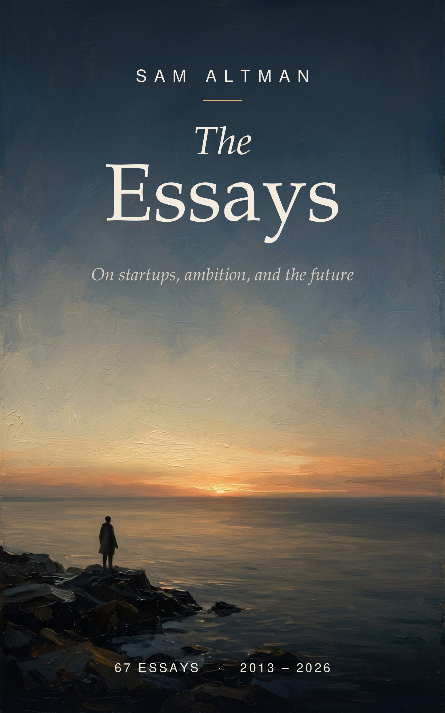

# Sam Altman Essays

[](https://github.com/nishachay/altman-essays/actions/workflows/build.yml)



> "The days are long but the decades are short."

---

**Grab the [latest EPUB] from the [releases page]. It rebuilds itself every week.**

The best of [Sam Altman's blog] in one EPUB, for [AFK] reading on a Kindle, Kobo, Apple Books or your phone. Sixty-seven essays, about 70,000 words, from 2013 to 2026: *How To Be Successful*, *Productivity*, *The Days Are Long But The Decades Are Short*, *How to Hire*, *The Gentle Singularity*, *Startup Advice* and more, plus Richard Hamming's *You and Your Research*, which Sam reposted on his blog.

## Why curated

The blog has 121 posts, and not all of them are essays. This collection keeps the writing worth learning from and leaves out product launches, investment announcements, politics, COVID-era notes, market takes and personal news.

- [`posts.txt`](./posts.txt) lists every essay in the book
- [`skipped.txt`](./skipped.txt) lists what was left out, so nothing is hidden

Think a post belongs (or doesn't)? Open a PR that moves its URL from one file to the other.

## How it works

1. `build.py` fetches each essay in `posts.txt`, orders them newest first and builds the EPUB with [pandoc], with a table of contents.
2. `make_cover.py` draws the cover over a painted dawn (`art/cover-art.jpg`).
3. A GitHub Action rebuilds on every push and every Monday, and publishes to the `latest` release.
4. When Sam publishes something new, `check_new.py` opens an issue. A human decides whether it goes in, so the book never fills up with announcements.

## Build it yourself

You need Python 3 and [pandoc].

```bash
pip install -r requirements.txt
python make_cover.py
python build.py        # writes dist/altman.epub
```

To read on Kindle, send the EPUB through [Send to Kindle].

---

_All essays are © Sam Altman and link back to the originals. This project only collects publicly posted writing for easier reading. Inspired by [ofou/graham-essays]. Ideas, fixes and feedback are welcome as issues or PRs._

[latest EPUB]: https://github.com/nishachay/altman-essays/releases/download/latest/altman.epub
[releases page]: https://github.com/nishachay/altman-essays/releases
[Sam Altman's blog]: https://blog.samaltman.com
[AFK]: https://www.grammarly.com/blog/afk-meaning/
[pandoc]: https://pandoc.org/installing.html
[Send to Kindle]: https://www.amazon.com/sendtokindle
[ofou/graham-essays]: https://github.com/ofou/graham-essays
